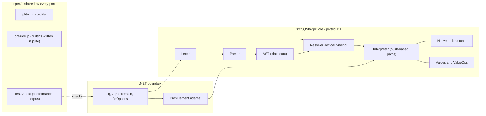

# Make JQSharp the portable reference implementation of jqlite

Today the engine cannot serve as a reference: its semantics live in `System.Text.Json` types, C# iterators and .NET exceptions, 2,000-line classes dispatch builtins by string at run time, and core rules (scoping, precedence, `try`, object construction) are wrong in ways the tests do not see. After this work JQSharp is a layered core that reads the same in six languages, a written **jqlite profile** says what the language is, and one **conformance corpus** checks the reference and every future port.

Backward compatibility is not kept: this is a 2.0.

## What changes



Each box of the core is one folder with the same name in every port. Nothing in the core knows `System.Text.Json`, LINQ iterators or .NET exceptions.

### The jqlite profile and its corpus (`spec/`)

`spec/jqlite.md` is the single source of truth: grammar with its precedence table, value model, the meaning of each construct, the builtin catalogue (name/arity, native or prelude), the error messages, the limits, and the deliberate differences from jq. `.github/design.md` and `.github/product.md` (the old design and phase list) are replaced by it.

The profile is everything JQSharp implements today: the language constructs, every name that `builtins` lists (regex, dates with local time, `$ENV`/`env` and the math of `MathExtra.cs` included) and the `@` formats. `import`, `include` and `modulemeta` are its one optional group: a port may leave them out. Inside the profile jqlite behaves as jq 1.8, except for a short list written in the spec:

- Numbers are IEEE-754 doubles, written in canonical text (shortest round-trip).
- A lone surrogate in a string becomes U+FFFD.
- Regular expressions have no lookaround and no backreferences.
- Recursion stops at a depth limit; there are no tail calls.
- `erf`, `erfc`, `tgamma`, `lgamma`, `j0` and `j1` are defined by the formulas of `MathExtra.cs` (`erf` is exact to about 1.5e-7), since most standard libraries lack them.

`spec/tests/*.test` is the corpus, in the jq test format that `src/Tests/JqTestParser.cs` already reads and that any language parses in twenty lines:

```
# spec/tests/scoping.test - program, input, then one expected output per line
1 as $x | def f: $x; 2 as $x | f
null
1

[try (1, error("x"), 3) catch .]
null
[1,"x"]
```

Most of the 463 C# facts have the shape `Assert.Equal([...], EvaluateToStrings(program, input))` and move into these files; only tests of the .NET API stay in C#. Cases on transcendental math round inside the program (`sin * 1e9 | round`) and local-time cases run with a fixed host offset, so every expected output is exact in every language. Today the upstream `suite/jq.test` is filtered by a keyword list and silently skips every program that fails to parse (`JqSelectorTests.cs`), so it measures little.

### A value model of its own (`Core/Values`)

Today every intermediate value is a `JsonElement`: creating `1 + 1` writes JSON bytes, parses a `JsonDocument` and clones it, and appending to an array re-serializes the whole array (3 GB allocated for 10,000 appends, see Evidence). Arithmetic exists in four copies (`BinaryOpFilter`, `CompoundAssignmentFilter`, `BuiltinFilter.AddValues`, `ParameterizedFilter.Add`) that already disagree on key order, and the element factory in six.

```csharp
// Core/Values/JqValue.cs - no System.Text.Json
enum JqKind { Null, False, True, Number, String, Array, Object }

readonly struct JqValue
{
    public JqKind Kind { get; }
    public double AsNumber();     // IEEE-754 double; NaN and ±Infinity exist inside the engine
    public string AsString();     // length, slices and ordering are by Unicode code point
    public JqArray AsArray();     // immutable sequence
    public JqObject AsObject();   // immutable map, insertion-ordered
}
```

`ValueOps` holds the one implementation of equality, ordering and `+ - * / %`; `ValueText` the one JSON writer and number formatter. `Json/JsonElementAdapter.cs` converts at the boundary and is the only file that uses `System.Text.Json`.

### Lexer, parser and a plain AST (`Core/Syntax`)

Today the parser is scannerless and re-parses text: object values are cut out with `ReadUntilTopLevel` and handed to a new parser, `include` splices the module source in front of the remaining program text, and indexes accept only literals. The new parser has a lexer with line and column, one precedence table, and AST nodes that are immutable records without behavior.

| Program | Today | With the new parser |
| --- | --- | --- |
| `{a, b}`, `{$x}`, `{a: (1,2)}` | parse error, parse error, one object | shorthand keys, two objects |
| `.[1+1]`, `.["a"+"b"]`, `.[1:$n]` | parse error | any expression |
| `1, 2 as $x \| $x * 10` | `10, 20` | `1, 20` |
| `1 // 2 == 2` | `false` | `1` |

### Lexical binding (`Core/Binding`)

Today variables and closure parameters are looked up by name in the caller's environment, so functions see the variables of whoever calls them, and `ParameterizedFilter` keeps the current environment in a mutable field of the AST node, which breaks recursion and the documented thread safety. The resolver walks the AST once, binds every variable, parameter, function call (user, prelude, native) and label to its definition, and reports unknown names with a position at parse time. A simple `$name` with no definition stays a host variable, as `AGENTS.md` describes.

### One push-based interpreter (`Core/Runtime`)

Today 37 node classes each return a C# iterator, `try`, `label` and the top-level `Evaluate` buffer all results to be able to catch exceptions, and paths are a separate `switch` over node types (`PathResolver.GetPaths`) that covers a few forms. The interpreter is one file with one shape:

```csharp
// Called once per output; the returned signal says whether to go on.
delegate Signal? Emit(JqValue value, Path? path);

Signal? Eval(Node node, Env env, JqValue input, Path? path, Emit emit);

// Signal: Error(JqValue) | Break(label) | Halt. null means "continue".
```

- **Outputs are pushed**, so evaluation is lazy by construction and nothing is buffered; `limit` and `first` stop through `Break`.
- **No exceptions inside the engine.** Errors, `break` and `halt` are returned signals; `JqException` is thrown only at the public boundary.
- **Paths are part of evaluation**: with `path` set, every node reports where each output came from, so `path(f)`, `del`, `|=`, `=` and `paths` work for every expression instead of a list of special cases.
- **A depth limit** turns runaway recursion into an error. Today depth 8,000 kills the process.

This shape exists in all six languages: a callback plus a returned status is Go's `iter.Seq` (`func(yield func(V) bool)`), Rust's `FnMut(Value) -> ControlFlow`, a functional interface in Java, a closure in TypeScript and Python.

### A small native table and a shared prelude (`Core/Builtins`)

Today `BuiltinFilter` (1,178 lines) and `ParameterizedFilter` (1,988 lines) switch on the builtin's name at each evaluation, and an unknown `foo(1)` fails only when it runs. Natives become a table of `name/arity -> function` bound by the resolver. Everything that can be said in jqlite is said once, in a file every port embeds as is:

```jq
# spec/prelude.jq
def map(f): [.[] | f];
def select(f): if f then . else empty end;
def recurse(f): def r: ., (f | r); r;
def to_entries: [keys_unsorted[] as $k | {key: $k, value: .[$k]}];
def with_entries(f): to_entries | map(f) | from_entries;
def del(f): delpaths([path(f)]);
def first(f): label $out | (f | ., break $out);
```

Unbounded generators (`range`, `repeat`, `while`, `until`) are native loops, so they do not consume the depth limit.

### Host boundary and public API

```csharp
public static class Jq
{
    public static JqExpression Parse(string expression, JqOptions? options = null);
    public static IReadOnlyList<JsonElement> Evaluate(string expression, JsonElement input,
        IReadOnlyDictionary<string, JsonElement>? variables = null);
}

public sealed class JqExpression
{
    // Buffered: all results are computed before the list is returned (true today as well).
    public IReadOnlyList<JsonElement> Evaluate(JsonElement input,
        IReadOnlyDictionary<string, JsonElement>? variables = null);

    // Streaming: results are pushed as they are produced; return false to stop.
    public void Evaluate(JsonElement input, Func<JsonElement, bool> onResult,
        IReadOnlyDictionary<string, JsonElement>? variables = null);
}

public sealed class JqOptions   // all that the pure core needs from its host
{
    public JqResolver? Resolver { get; init; }                              // import / include
    public IReadOnlyDictionary<string, string>? Environment { get; init; }  // $ENV, env; null = process
    public TimeProvider TimeProvider { get; init; } = TimeProvider.System;  // now, and the zone of localtime
    public int MaxDepth { get; init; } = 1000;
}

public class JqException : Exception { public JsonElement? Value { get; } }
public sealed class JqParseException : JqException { public int Line { get; } public int Column { get; } }
```

The JSONL `EvaluateAsync` helpers stay, as one overload each. `JQSharp.csproj` gets `<IsAotCompatible>true</IsAotCompatible>`: today a string literal in a program throws in an app with reflection-based JSON disabled, because the parser calls `JsonSerializer.Serialize`.

## Steps

- [x] 1. **Corpus first, on the current engine.** Create `spec/tests/*.test` from the one-line facts in `src/Tests/Jq*Tests.cs` and from the Evidence cases. Add `src/Tests/ConformanceTests.cs` (one theory over every case) and `spec/tests/pending.txt`, the cases the current engine fails: the run fails when a listed case passes or an unlisted one fails. Delete the converted facts.
  - Done: 452 cases in 21 files, every expected output checked against jq 1.8.2; 41 pending. `localtime.test` (fixed host zone UTC+02:00) is skipped until step 10. The 44 module tests stay in C# (the one-line format cannot carry module sources); the recursion-depth case kills the current process, so it comes with step 11.
- [x] 2. **Write `spec/jqlite.md`**: grammar and precedence, values and ordering, number and string rules, each construct, the builtin catalogue (taken from the name lists of `BuiltinFilter`, `ParameterizedFilter` and `FormatFilter`, each marked native or prelude, modules marked optional), error messages, limits, differences from jq.
  - Done (1,107 lines; 188 public builtins: 100 native, 88 prelude) and validated: every example was run through jq 1.8.2. `spec/prelude.jq` was written here, ahead of step 7 (91 definitions): substituted for jq's own builtins it passes 451 of the 452 corpus cases in jq, the other being the stated `break` through `try` difference.
  - Open for the user: `repeat(f)` follows jq 1.8.2 (`1 | repeat(. + 1)` gives `2, 2, 2...`), which differs from older jq (`1, 2, 3...`); the special-function formulas of `MathExtra.cs` are specified as they are, with their weak points noted in §9.8.
  - Still to apply in `spec/tests/README.md` (with step 6): `%%FAIL` messages are compared only for the fixed texts of §10.2; a case may end by `halt`; outputs are compared as they read back from canonical text (NaN is `null`).
- [x] 3. **`Core/Values`**: `JqValue`, `JqArray`, `JqObject`, `ValueOps`, `ValueText`, with unit tests for ordering, arithmetic, number text and code-point handling.
  - Done, with `CodePoints`, `JqObjectBuilder` and `ValueErrors` beside them. Fallible operations are `bool TryX(..., out JqValue result, out JqValue error)`. Arrays and objects append in amortized O(1) through a shared buffer (the Go-slice idea), which the scaling gate needs. To reconcile with the spec once step 2 lands: `implode` of an invalid code point (jq 1.8.2 gives U+FFFD, the layer returns an error) and `"s" * 0`.
- [x] 4. **`Core/Syntax`**: `Token`, `Lexer`, `Ast`, `Parser`, with tests for precedence, object construction, interpolation and error positions.
  - Done (436 tests): `Parser.TryParse` / `TryParseModule` return the `Program` or one `SyntaxError` (message, line, column), nothing throws. The parser applies the rewrites of §3.3 of the spec. Every corpus program and `spec/prelude.jq` parse. Probing jq 1.8.2 found nine places where the spec's grammar was wrong (`def`/`label` as operands, `as` in object values, trailing comma, `.[:]`, qualified definition names, module metadata, comments at a lone CR, the `{"\(e)"}` rewrite): the parser follows jq, the spec is being corrected.
- [x] 5. **`Core/Binding`**: `Resolver` and its scopes; unknown function, variable or label is a `JqParseException`.
  - Done (167 tests): the resolver builds a bound tree of its own node types (`Bound.cs`), where every reference is hops and a slot, a function index or a native; only host variables stay named. It walks with an explicit task stack, not recursion. The native catalogue (`Core/Builtins/Natives.cs`, 105 names) came with this step, and `spec/prelude.jq` is embedded and bound once; a test checks that catalogue plus prelude are exactly the builtins of §9 of the spec. `import`/`include` are a binding error until step 9; the public exception type comes with step 10.
- [x] 6. **`Core/Runtime`**: `Interpreter`, `Env`, `Path`, `Signal`, `Errors` (the message catalogue), `MaxDepth`.
  - Done (2,063 tests): one `Interpreter.cs` with `Eval` (outputs pushed, signals returned) and `EvalOne` for nodes the resolver marks as giving at most one output; the natives of the evaluation model (core, loops, paths, collections, strings) in `Core/Builtins`; the one error catalogue is `Core/Values/Errors.cs`. The corpus on the new core: 377 of 487 cases pass, the 110 in `pending-core.txt` all wait for natives of steps 7 and 8.
  - Measured (Release, warm): `[range(100000)] | map(. + 1) | add` 24.6 ms / 25.6 MB; `reduce range(10000) as $i ([]; . + [$i]) | length` 2.3 ms / 3.5 MB; `range(2000000)` first result ~0; `[range(4000)] | .[] |= . + 1 | length` 21.6 ms / 252 MB, which misses the 10x memory gate (8x).
  - Follow-up done (2,644 tests): `_modify/2` and `_assign/2` have native versions that update a working copy in place (the prelude definitions stay normative; the corpus runs a third time with the native versions off, and both agree), so `[range(4000)] | .[] |= . + 1 | length` now takes 1.1 ms / 1.26 MB. When the host stack runs short below `MaxDepth`, evaluation continues on a fresh 16 MB stack (`Core/Runtime/StackGuard.cs`, the runtime's one host-specific file), so `MaxDepth` is reached exactly on 1 MB and 256 KB threads in Debug. `delpaths` no longer recurses. `?//` in `reduce`/`foreach` and computed pattern keys follow the rules added to the spec.
  - Deviation: from this step on, `ConformanceTests` also runs the corpus on the new core, with a temporary `spec/tests/pending-core.txt` that shrinks through steps 7 to 9 and is deleted at step 10, so each step is checked as it lands instead of all at once at the switch.
- [x] 7. **`Core/Builtins`**: the native table (collections, strings, paths, formats, `env`) and `spec/prelude.jq` embedded as a resource; `builtins` is generated from both.
  - Done (3,506 tests, the corpus now counted three times): the catalogue, the prelude resource and most natives came with steps 5 and 6; this step added the formats (`@html`, `@uri`, `@urid`, `@csv`, `@tsv`, `@sh`, `@base64`, `@base64d`) and `contains/1` as plain loops, and a pass over §9 of the spec against jq 1.8.2 that added 286 corpus cases (new `builtins.test`). `pending-core.txt` is down to 80 cases: regex 19, dates 14, math 47.
- [ ] 8. **Regex, dates and math.** Regex natives on `RegexOptions.NonBacktracking`; `StrftimeFormat.cs` and `MathExtra.cs` move under `Core/Builtins` and work on `JqValue`; local time takes its zone from `JqOptions.TimeProvider`.
- [ ] 9. **Modules, the optional group.** `import` and `include` become AST nodes; a loader over `JqResolver` parses and links the modules, with no text splicing; `modulemeta` reads what the loader recorded.
- [ ] 10. **Switch.** Add `Json/JsonElementAdapter.cs`, `JqOptions`, `JqParseException`, the new `Jq` and `JqExpression`. Run the corpus on the new engine until `pending.txt` is empty, then delete it and the old engine: `Filters/`, `JqFilter.cs`, `JqEnvironment.cs`, `JqPattern.cs`, `PathResolver.cs`, `FilterClosure.cs`, `JqBreakException.cs`, `JqHaltException.cs`, `JqParser.cs`.
- [ ] 11. **Guard rails.** `IsAotCompatible` in `JQSharp.csproj`; a test that fails when a file under `src/JQSharp/Core` uses `System.Text.Json` or `yield return`; a test that evaluates one `JqExpression` from many threads with different variables; a recursion-depth test.
- [ ] 12. **Benchmarks.** Add the four scaling cases of Evidence to `src/Benchmarks` beside the WhatsApp one; refresh the table in `readme.md`.
- [ ] 13. **Docs.** Rewrite the architecture part of `AGENTS.md` (layers, portability rules, spec as source of truth); update `readme.md` (API, profile); add `docs/porting.md` (folder-to-module map, notes per language); delete `.github/design.md`, `.github/product.md`, `.github/prompt.md`.

## How it is verified

- [ ] `dnx --yes retest` is green after each step; after step 10 `spec/tests/pending.txt` is gone and every corpus case passes.
- [ ] Every row of the Evidence tables is a corpus case and passes.
- [ ] `dotnet build` reports no `IL2026`/`IL3050` warning for `JQSharp.csproj`.
- [ ] `def f: if . == 0 then 0 else (. - 1 | f) end; 100000 | f` throws `JqException` and the test process survives.
- [ ] The scaling cases take at least 10 times less time and memory than in Evidence; the WhatsApp benchmark is not slower than today (15.5 µs, 55 KB with a cached expression).
- [ ] `dotnet format whitespace --verify-no-changes` and `dotnet format style --verify-no-changes` pass.

## Decisions

| Decision | Choice | Why |
| --- | --- | --- |
| Scope of jqlite 1.0 | Everything JQSharp has today; modules are the one optional group | Decided in review: no feature is lost, each port reproduces all of it |
| Fidelity | jq 1.8 inside the profile, with the short list of differences in the spec | Decided in review: jq documentation stays valid for jqlite users |
| Patch or rebuild | New core beside the old engine, switched when the corpus passes | The faults are in the shape (value type, scoping, evaluation): every file changes either way |
| Evaluation model | Tree-walking, outputs pushed to a callback, unwinding by returned signal | Confirmed in review. The only shape all six languages have; lazy; no exceptions as control flow |
| Not a bytecode VM | Rejected for now | jq's own design and immune to host stack depth, but twice the code to port and hard to read as a reference |
| Values | Own immutable model, numbers are doubles, canonical number text (shortest round-trip, ECMAScript layout) | Removes the host JSON library from the semantics; each port uses its natural types |
| Builtins | Native only where needed, the rest in `spec/prelude.jq` | Written once for all ports; paths come for free |
| Recursion | Depth limit with an error; native loops for unbounded generators | Host stacks differ (Python stops at 1,000 frames); no tail-call machinery to port |
| Error messages | Part of the spec, in one catalogue | Programs read them through `try ... catch .` |
| Regex dialect | Common subset without lookaround and backreferences; .NET runs it with `RegexOptions.NonBacktracking` | Go and Rust engines have nothing more; linear time on untrusted patterns |
| Math without a standard library | `erf`, `tgamma`, `lgamma`, `j0`, `j1` are specified as the formulas now in `MathExtra.cs` | JavaScript, Java and Rust have none of them; a formula ports exactly |
| Local time | The zone comes from the host (`JqOptions.TimeProvider`); the corpus fixes it | Keeps `localtime` and `strflocaltime` in the profile without making results depend on the machine |
| Spec location | `spec/` in this repository | One place until a port needs it elsewhere |

## Risks

- **Size.** About 7,000 lines are replaced. The corpus comes first, both engines coexist, and the switch is a single step that can be delayed.
- **Visible behavior changes** (precedence, object construction, `try`, scoping). They are fixes, but existing filters may rely on the old results: major version, listed in the release notes.
- **Small inputs could get slower**, since the input is converted to `JqValue` up front. The WhatsApp benchmark gates it; the fallback is an adapter that wraps input containers lazily.
- **Prelude builtins slower than native ones** (`to_entries`, `walk`, `paths`). Benchmarks decide which to promote to the native table; semantics do not change.
- **`NonBacktracking` regex** may differ in capture details, and filters that use lookaround or backreferences stop working. The regex corpus file decides the first; the fallback is the backtracking engine behind a pattern validator.
- **The whole feature set weighs on every port**: regex, `strftime`/`strptime`, local time and the extra math have no common library. The spec gives each a definition that needs none (the formulas of `MathExtra.cs`, the format table of `StrftimeFormat.cs`), and the corpus covers them.

## Out of scope

- The ports themselves, and a parser-level corpus (AST dumps) for them.
- Full jq parity, the jq command line, and passing the whole upstream `suite/jq.test`; it stays a source of cases.
- Builtins JQSharp does not have today: `input`/`inputs`, `debug`, `stderr`, `tostream`/`fromstream`.
- A bytecode VM, tail calls, persistent collections, cancellation or step budgets. The interpreter keeps one place where they can be added.
- `docs/manual.md`, the copy of the jq manual.

<details><summary>Evidence: what was run against the current engine</summary>

Semantics (Release build of `main`, each program run through `Jq.Evaluate`):

| Area | Program (input) | Today | Should be |
| --- | --- | --- | --- |
| Scoping | `1 as $x \| def f: $x; 2 as $x \| f` | `2` | `1` |
| Shared state | `def f($d): map(if type == "array" then f($d + 1) else $d end); f(0)` on `[[1],2]` | `[[1],1]` | `[[1],0]` |
| Labels | `[label $f \| def g: break $f; (label $f \| 1, g, 2), 3]` | `[1,3]` | `[1]` |
| `try` | `[try (1, error("x"), 3) catch .]` | `["x"]` | `[1,"x"]` |
| `reduce` | `reduce (1,2,3) as $x (0; empty)` | `InvalidOperationException` | `null` |
| Objects | `{a: empty}` | `{"a":null}` | no output |
| Logic | `false and error("x")` | error | `false` |
| Operands | `[(1,2) + (10,20)]` | `[11,21,12,22]` | `[11,12,21,22]` |
| Update | `.a += (1,2)` on `{"a":0}` | one output | two outputs |
| Leaks | `try ("{" \| fromjson) catch "caught"` | `JsonReaderException` | `"caught"` |
| Leaks | `"nan" \| tonumber`, `[1114112] \| implode` | `ArgumentException`, `ArgumentOutOfRangeException` | a value or a jqlite error, never a host exception |
| Text | `"é<" \| tojson` | `"\"\\u00E9\\u003C\""` | `"\"é<\""` |
| Strings | `"aé😀b" \| .[2:3]` | half of a surrogate pair | `"😀"` |
| Ordering | `{"a":2,"b":1} < {"a":1,"c":0}` | `false` | `true` |

Scaling (same build, one warm run each):

| Program | Time | Allocated |
| --- | --- | --- |
| `[range(100000)] \| map(. + 1) \| add` | 0.5 s | 577 MB |
| `reduce range(10000) as $i ([]; . + [$i]) \| length` | 3.1 s | 3.0 GB |
| `[range(4000)] \| .[] \|= . + 1 \| length` | 1.5 s | 2.0 GB |
| `range(2000000)`, taking only the first result | 1.1 s | 1.5 GB |
| `def f: if . == 0 then 0 else (. - 1 \| f) end; 8000 \| f` | process dies of stack overflow | |

Read in the code, not run: `sort_by`, `group_by` and `unique_by` use `Array.Sort`, which is not stable (`ParameterizedFilter.cs:1212`); an imported module sees the importer's functions and variables, and its nested definitions are exported (`JqParser.cs:878`, `JqParser.cs:641`).

</details>
