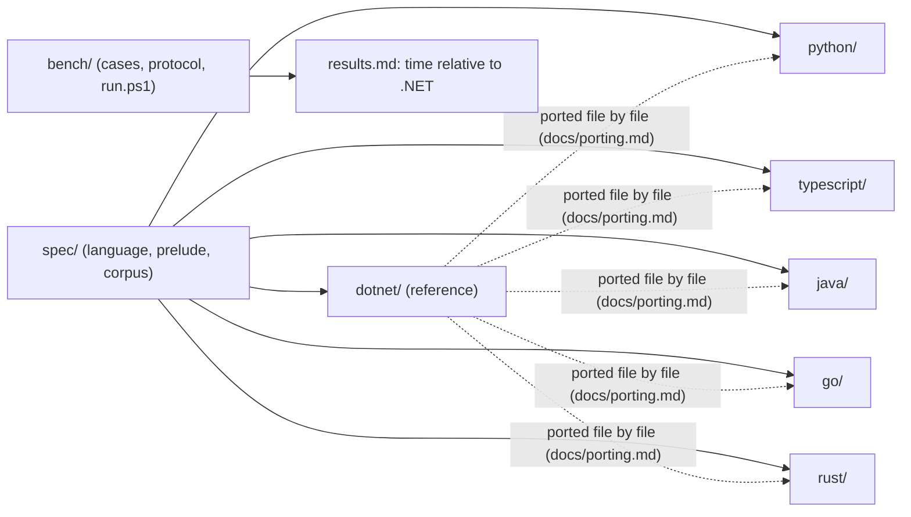

# Port jqlite to Python, TypeScript, Java, Go and Rust

The reference (`dotnet/JQLite/Core`, 12,000 lines of C#) was built to be ported 1:1. This plan carries it to five languages, each in a folder beside `dotnet/`, each proven by the same conformance corpus, and ends with a table that compares their speed with .NET's.

## Who does what

| Port | Folder | Model | Why this model | Toolchain here |
| --- | --- | --- | --- | --- |
| Rust | `rust/` | Fable | the design departs most from the reference: ownership, `Rc`/`Arc`, signals by value, `stacker` | rustc/cargo 1.96 |
| TypeScript | `typescript/` | Fable | the host stack cannot grow (§11), UTF-16 code points, object key order, no `fma` | Node 24, npm 12 |
| Go | `go/` | Opus (high) | maps closely; import cycle, array buffers and regex start position are spelled out in the guide | Go 1.26 |
| Java | `java/` | Opus (high) | maps almost line by line from C# | Temurin JDK 21 in `~/.jdks/jdk-21.0.13+9` (not on the PATH), Maven through its wrapper |
| Python | `python/` | Opus (high) | maps closely; recursion limit and threads are spelled out in the guide | Python 3.13 |
| Review of each port | read-only | Sonnet | checking a finished port against the rules below is reading, not design | |

From 2026-11-18 on, by the user's instruction, no further sub-agent runs on Fable: any new session, and any further prompt to the Rust or TypeScript session, uses Opus or Sonnet.

The parent session (Fable) writes this plan and the benchmark, starts the sub-agents, checks each result itself (corpus, tests, benchmark outputs) and brings the folders into the project.

## Rules for every port

Read first, in this order: `AGENTS.md`, `docs/porting.md` (the guide: follow it), `spec/jqlite.md`, `spec/tests/README.md`, then the reference file you are porting. Where the spec and the reference disagree, the spec wins.

**Scope and layout**

- Write only inside your folder. Do not change `spec/`, `docs/`, `dotnet/`, `bench/`, other ports or files of the repository root. If the spec, the guide or the reference looks wrong or misleading, do not fix it: report it with the evidence.
- Port the whole engine, the modules group (§9.11) and the native `_modify`/`_assign` overrides included.
- One file per reference file, with the names of `docs/porting.md` §1.3, and the same type and function names in the language's case, so two ports can be read side by side. Say in the header of each host-specific file (the ones marked **H** in the guide) what it uses from the host.
- The layers and the portability rules of `AGENTS.md` hold in every port: the core uses no host JSON library, no generators or iterators to produce outputs (outputs are pushed), no reflection, no exceptions as control flow (errors are values, `Error`/`Break`/`Halt`/`Stop` are returned signals), host regex, date and culture APIs only in the files that exist for that, and no recursion whose depth comes from data.
- No run-time dependency beyond the language's standard library. The one exception is Rust: `regex` (and `stacker` for the stack), since its standard library has neither. Test and build tools are free.
- Embed `spec/prelude.jq` unchanged. Refer to the shared file where the toolchain can (`include_str!`, a Maven resource folder); where it cannot (Go embed, Python package data, a generated TypeScript module), copy it with a build step and add a test that fails when the copy differs from `spec/prelude.jq`.
- The root `.gitignore` ignores folders named `bin`, `obj`, `out`, `results`, `artifacts`, `pack`, and files `*.log`, `*.cache`, `*.zip`, `*.lock.json`, `package-lock.json`: do not give a source folder one of these names. Add a `.gitignore` in your folder for your build outputs (and to keep a lock file the root ignores).

**Host boundary** (guide §3.8; spec §12): thin and idiomatic, outside the core, with the features of the .NET one (`AGENTS.md`, "Host boundary" and "External variable bindings"):

- parse once into an immutable expression that is safe to evaluate from many threads; evaluate into a list, or stream the outputs and stop early;
- host variables (names validated before evaluation, `ENV` rejected), and options: module resolver (with a file resolver), environment for `$ENV`, clock and zone, `MaxDepth`, `debug` and `stderr` handlers;
- errors become host errors only here: a parse error with line and column, a run-time error with its value, a halt error with its exit code;
- host values: TypeScript and Python take and return the language's own JSON values (plain objects/arrays, `dict`/`list`), keeping key order; Java, Go and Rust have no standard ordered JSON value, so they expose the port's value type with conversions from and to JSON text (Go also from and to `any`).

**Tests** (guide §4): the port is done when all of these pass.

- The corpus, read from the shared `spec/tests/` (not copied), run by the rules of `spec/tests/README.md` **twice**: through your public API, and through the core without the native overrides. `localtime.test` with a zone fixed at UTC+02:00, `modules.test` over `spec/tests/modules/`. Every case of every file must pass both ways: a skipped or special-cased test is a failure to report, not a way to pass.
- The catalogue test: the N and P lists of §9, read from the spec, against your native catalogue and the prelude (`BuiltinCatalogueTests`).
- Limits (§11) on the default stack of a thread of your language: 1,000 levels of program nesting parse and bind, values 10,000 deep are read, written and compared, a recursion reaches `MaxDepth` and gives `Maximum call depth exceeded`, never a host stack failure.
- One expression evaluated from many threads at once (where the language has threads).
- The unit tests of `dotnet/Tests/Core/<Layer>/` ported with the code they cover (guide §4.3): values, lexer, parser, resolver, interpreter, assign. If you leave some out, say which and why.
- The language's own checks are clean: formatter and linter (`gofmt` and `go vet`, `cargo fmt` and `cargo clippy`, `tsc --strict`, `javac -Xlint:all`, type hints that pass a checker if you install one).

**Benchmark**: write the runner of `bench/README.md` (reference: `dotnet/Benchmarks/CrossBench.cs`) on your core engine and `<port>/bench.json`. Check it yourself on every case of `bench/cases.json`: the output file must equal `bench/cases/<name>.expected` byte for byte. Once the corpus passes, profile the benchmark cases and remove what is needlessly slow in your port (an accidental quadratic loop, a copy per element, a regex compiled on every call) while keeping the structure of the reference.

**README**: `<port>/README.md` says how to build, test and run the benchmark, shows the public API with a short example, and lists every deliberate difference from the reference's structure with its reason.

**Git**: you work in a git worktree of your own, on its branch. Commit there at each milestone (a layer working, the corpus passing), only files of your folder; never push, never switch or create branches, and do not touch the project folder.

**Order** (guide §4.2): values, syntax, binding, runtime with the core natives, then builtins by family, modules last; run the corpus as soon as the runtime exists and keep it running. Do not stop before the whole corpus passes both ways; if something truly blocks you, report exactly what and where.

**Report**, when done: the commands that build and test, with their real output counts (corpus cases passed each way, unit tests); the benchmark check (cases whose outputs match); the list of differences from the reference; anything in the spec, guide or reference that was wrong or unclear; what is not done.

## Steps

- [x] Benchmark protocol, cases and expected outputs (`bench/`), the .NET runner (`dotnet/Benchmarks/CrossBench.cs`), `bench/run.ps1`
- [x] JDK 21 for the Java port (`~/.jdks/jdk-21.0.13+9`)
- [x] Single calls (task `bd5n`): spec §7.7 and §11, corpus cases, reference; sent to the five sessions as commit `3074345` of `alta/port-base` to cherry-pick and port (the new cases of `functions.test` prove it in each port)
- [x] Rust port: corpus 1,108/1,108 both ways, 225 tests, clippy and rustfmt clean, benchmark outputs match; verified by the parent, reviewed (portability test, regex limits, stack guard beside the layers) and brought into `rust/` (branch `alta/candid-stratus-wx94`)
- [x] TypeScript port: corpus 1,108/1,108 both ways, 2,589 tests, type checks, benchmark outputs match; verified by the parent, reviewed (regex matcher made linear, patterns no longer recurse) and brought into `typescript/` (branch `alta/toasty-canyon-k5fg`)
- [x] Go port: corpus 1,108/1,108 both ways, 178 tests, benchmark outputs match; verified by the parent and brought into `go/` (branch `alta/swift-jaguar-ds7t`); `-race` not run (no C compiler here)
- [x] Java port: corpus 1,108/1,108 both ways, 3,460 tests, benchmark outputs match; verified by the parent and brought into `java/` (branch `alta/snug-shuttle-c52s`)
- [x] Python port: corpus 1,108/1,108 both ways, 2,454 tests, benchmark outputs match; verified by the parent and brought into `python/` (branch `alta/sparkling-shrike-82rg`)
- [x] Parent: each port verified in its worktree and again in the project folder (tests, checks, benchmark outputs), reviewed read-only by a Sonnet session, the review's points sent back and fixed, and the folder brought in from its branch
- [x] `docs/porting.md` (§5 and the corrections the ports found), `AGENTS.md` (Ports), `readme.md`, `bench/README.md` (the baseline is .NET 10)
- [x] `bench/run.ps1` on all six, .NET 10.0.15 as the baseline, every output equal to `.expected`: geometric means of evaluate 1.19× (Rust), 2.22× (Go), 0.92× (Java), 1.61× (TypeScript), 15.0× (Python); tables in `bench/results/results.md`
