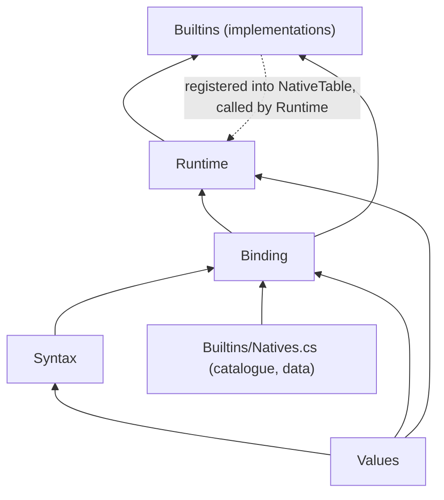

# Porting jqlite

How the reference implementation (JQSharp, C#) is built and how to carry it to JavaScript/TypeScript, Python, Java, Go and Rust. Read [`spec/jqlite.md`](../spec/jqlite.md) first: the spec says *what* jqlite does, this guide says how the reference does it. Where they disagree, the spec wins and the reference has a bug.

What every port shares, unchanged:

| File | Role |
| --- | --- |
| `spec/jqlite.md` | the language: grammar, values, semantics, builtins, errors, limits (§1–§14) |
| `spec/prelude.jq` | the builtins written in jqlite; embedded as is |
| `spec/tests/*.test`, `spec/tests/modules/` | the conformance corpus (§14, `spec/tests/README.md`) |

## 1. The map

`src/JQSharp/Core` is the whole engine. Nothing in it uses `System.Text.Json`, LINQ iterators, `yield return`, reflection, culture-sensitive APIs or exceptions as control flow, so each file ports on its own. The public .NET API (`Jq`, `JqExpression`, `JqOptions`, the exceptions, the resolvers) and its adapters (`Json/JsonElementAdapter.cs` for values, `Host/ResolverSource.cs` and `Host/TimeProviderClock.cs` for the module source and the clock) sit outside `Core` and are not ported: each port writes its own host boundary (3.8).

### 1.1 Layers



An arrow means "is used by". Values depends on nothing; Syntax on Values; Binding on Syntax, Values and the native *catalogue*; Runtime on Binding and Values; the native *implementations* on everything below them.

The one cycle: the interpreter calls natives through `Builtins/NativeTable.cs`, and the natives call back into the interpreter. C#, Java, Rust (one crate) and JavaScript accept it. Go forbids import cycles and Python dislikes them, so there: put the two native function types and the table in the runtime package, and let the builtins package fill the table at start-up (as `NativeTable`'s static constructor does through each family's `Register()`).

### 1.2 Files

Host-specific files are marked **H**; the modules group (§9.11, optional) is marked **M**.

| File | Holds | Uses |
| --- | --- | --- |
| **Values/** | | |
| `JqValue.cs` | the value: kind + payload (§4.1) | — |
| `JqArray.cs`, `JqArrayBuilder.cs` | immutable arrays sharing a buffer; private builder (§4 below) | JqValue |
| `JqObject.cs`, `JqObjectBuilder.cs` | immutable insertion-ordered maps sharing a buffer; builder | JqValue |
| `CodePoints.cs` | length, slices, ordering, explode by code point; lone surrogates to U+FFFD | — |
| `Utf8.cs` | UTF-8 encode/decode loops (§4.1 decoding) for the byte formats | CodePoints |
| `ValueOps.cs` | equality, ordering, arithmetic, slicing, sorting (§4.2–§4.4, §7.6) | all of Values |
| `ValueText.cs` | the JSON writer, number formatter (§5.1, §5.2), JSON reader (§5.3). **H**: the shortest-digits step and the decimal-to-double step use the host | all of Values |
| `Errors.cs` | every run-time message (§10.3, §9) and the error dump (§10.1) | ValueText |
| **Syntax/** | | |
| `Token.cs`, `Lexer.cs` | tokens and the lexer (§2) | Values |
| `Ast.cs` | the AST: immutable records with positions | Values |
| `Parser.cs` | recursive descent, §3; rewrites the forms of §3.3 | Lexer, Ast |
| `SyntaxError.cs` | the one error of lexing, parsing and binding: message, line, column, module | — |
| **Binding/** | | |
| `Bound.cs` | the bound program: node kinds, `AtMostOne`, (hops, slot) references | Values, catalogue |
| `Resolver.cs` | lexical binding (§7.5, §7.7, §7.15), binding errors (§10.2) | Syntax, catalogue |
| `Prelude.cs` | `spec/prelude.jq` parsed and bound once. **H**: reading the embedded resource | Resolver |
| `Modules.cs` **M** | `IModuleSource` (resolve, read), loading, `modulemeta` descriptions | Resolver |
| **Runtime/** | | |
| `Interpreter.cs` | `Eval`, `EvalOne`, every construct of §6–§8, the depth limit | Binding, Values, NativeTable |
| `Env.cs` | environment frames and closures | Binding |
| `Path.cs` | paths of path mode (§8.1) | Values |
| `Signal.cs` | `Error`, `Break`, `Halt`, `Stop` | Values |
| `Evaluation.cs` | `IClock`, `EvaluationOptions`, `Outcome` (§12) | Values |
| `StackGuard.cs` **H** | continuing on a fresh stack when the host stack runs short (§11) | — |
| **Builtins/** | | |
| `Natives.cs` | the native catalogue: every N of §9 in spec order, value or closure arguments | — |
| `NativeTable.cs` | the two native signatures and the implementations by catalogue index | Runtime |
| `CoreNatives.cs`, `LoopNatives.cs`, `CollectionNatives.cs`, `Containment.cs`, `StringNatives.cs`, `PathNatives.cs`, `Formats.cs` | the natives of §9.2–§9.6, §9.9 | Runtime, Values |
| `AssignNatives.cs` | native `_modify`/`_assign` overriding the prelude (§3 below) | Runtime |
| `MathNatives.cs`, `MathExtra.cs` | §9.8; `MathExtra` holds every formula and exact operation. **H**: the library functions of §9.8 | Values |
| `Calendar.cs`, `Strftime.cs`, `DateNatives.cs` | §9.7, §9.12: no host date type | Runtime |
| `RegexSyntax.cs` | the dialect of §9.10: validator and translator to the host's pattern syntax | Values |
| `RegexEngine.cs` **H** | the host regex engine: compile, match from a position | — |
| `RegexNatives.cs` | flags, search loop, match objects in code points | RegexSyntax, RegexEngine |
| `ModuleNatives.cs` **M** | `modulemeta/0` | Modules |

A port without modules drops `Modules.cs`, `ModuleNatives.cs`, the `Resolver.BindImports` call and `modulemeta/0` from the catalogue, and rejects `import`, `include`, `module` in its parser.

### 1.3 Names per language

| Folder | JS/TS | Python | Java | Go | Rust |
| --- | --- | --- | --- | --- | --- |
| package | `jqlite` (npm) | `jqlite` | `<group>.jqlite` | module `…/jqlite` | crate `jqlite` |
| Values | `src/values/` | `jqlite/values/` | `….jqlite.values` | `values` | `mod values` |
| Syntax | `src/syntax/` | `jqlite/syntax/` | `….jqlite.syntax` | `syntax` | `mod syntax` |
| Binding | `src/binding/` | `jqlite/binding/` | `….jqlite.binding` | `binding` | `mod binding` |
| Runtime | `src/runtime/` | `jqlite/runtime/` | `….jqlite.runtime` | `runtime` | `mod runtime` |
| Builtins | `src/builtins/` | `jqlite/builtins/` | `….jqlite.builtins` | `builtins` | `mod builtins` |
| a file, e.g. `ValueOps.cs` | `valueOps.ts` | `value_ops.py` | `ValueOps.java` | `value_ops.go` | `value_ops.rs` |

Keep one file per reference file and the same type and function names in each language's case, so a reviewer can put two ports side by side.

## 2. The shapes that carry over

### 2.1 The value

Seven kinds (§4.1); numbers are doubles. The reference packs a value in 16 bytes (a payload reference and a double); a port uses its natural sum type.

```csharp
// C#
enum JqKind : byte { Null, False, True, Number, String, Array, Object }   // in sort order
readonly struct JqValue { readonly object? payload; readonly double number; public JqKind Kind => …; }
```

```ts
// TypeScript: the host's own primitives, classes for containers
type JqValue = null | boolean | number | string | JqArray | JqObject;
```

```python
# Python: None, bool, float, str, JqArray, JqObject. bool is a subclass of int: test it before
# numbers, and never let an int in (the reader and tonumber give float).
JqValue = None | bool | float | str | "JqArray" | "JqObject"
```

```java
// Java 21
sealed interface JqValue permits JNull, JBool, JNumber, JString, JArray, JObject {}
record JNumber(double value) implements JqValue {}   // and so on; JNull and the two JBool are singletons
```

```go
// Go: a small struct, no interface boxing for numbers
type Value struct { kind Kind; num float64; ref any } // ref: string, *Array or *Object
```

```rust
// Rust
enum Value { Null, False, True, Number(f64), String(Rc<str>), Array(Rc<Array>), Object(Rc<Object>) }
```

Values are immutable everywhere; nothing in the engine ever observes identity of values (only of signals, 2.4).

### 2.2 Fallible operations

An operation that jq can fail returns the error as a jqlite value (usually the message string, §10), never by throwing. The reference spells it `bool TryX(…, out result, out error)`.

| Language | Shape |
| --- | --- |
| C# | `static bool TryAdd(JqValue a, JqValue b, out JqValue result, out JqValue error)` |
| TS | `tryAdd(a, b): JqValue \| Fail` with `class Fail { constructor(readonly error: JqValue) {} }` |
| Python | `def try_add(a, b) -> JqValue \| Fail` (same `Fail` class) |
| Java | `static Result tryAdd(JqValue a, JqValue b)`, `sealed interface Result permits Ok, Err` |
| Go | `func TryAdd(a, b Value) (result, err Value, ok bool)` (the error is a `Value`, not a Go `error`) |
| Rust | `fn try_add(a: &Value, b: &Value) -> Result<Value, Value>` |

`As*` accessors (`AsNumber()` …) throw only on a programming error; callers check the kind first.

### 2.3 Evaluation: push, with a returned signal

The interpreter is a tree walker that pushes outputs to a callback and returns why it stopped (§6.2). `null` means "done, go on".

```csharp
// C# (Runtime/Interpreter.cs)
delegate Signal? Emit(JqValue value, Path? path);
Signal? Eval(Node node, Env? env, JqValue input, Path? path, Emit emit);
```

```ts
type Emit = (value: JqValue, path: Path | null) => Signal | null;
eval(node: Node, env: Env | null, input: JqValue, path: Path | null, emit: Emit): Signal | null
```

```python
Emit = Callable[[JqValue, Path | None], Signal | None]
def eval(self, node, env, input, path, emit) -> Signal | None: ...
```

```java
@FunctionalInterface interface Emit { Signal emit(JqValue value, Path path); }  // null: go on
Signal eval(Node node, Env env, JqValue input, Path path, Emit emit);
```

```go
// iter.Seq-like, with a signal instead of a bool
type Emit func(v Value, p *Path) *Signal
func (in *Interpreter) Eval(n Node, env *Env, input Value, path *Path, emit Emit) *Signal
```

```rust
type Flow = std::ops::ControlFlow<Signal>;      // Break(signal) stops; Continue(()) goes on; `?` passes it up
fn eval(&mut self, n: &Node, env: &Option<Rc<Env>>, input: Value, path: Option<&Path>,
        emit: &mut dyn FnMut(Value, Option<Path>) -> Flow) -> Flow
```

`Signal` (`Runtime/Signal.cs`) is `Error(value)`, `Break(label)`, `Halt(value?, code)` or `Stop` (the host stopped the stream). Every construct passes a signal up unchanged, except the one that handles it.

`EvalOne` is the same evaluation for nodes the resolver marked `AtMostOne` (literals, arithmetic, indexes, object construction…): it returns the output instead of pushing it, so most of a program runs without callbacks.

| Language | `EvalOne` |
| --- | --- |
| C# | `Signal? EvalOne(Node, Env?, JqValue input, Path? path, out bool has, out JqValue value, out Path? at)` |
| TS | return `Signal \| null` and write `has/value/at` into a reusable scratch object of the interpreter |
| Python | `-> tuple[Signal \| None, bool, JqValue, Path \| None]` |
| Java | a mutable `One` holder passed in (`one.has`, `one.value`, `one.at`), returns `Signal` |
| Go | `func (in *Interpreter) EvalOne(…) (sig *Signal, has bool, v Value, at *Path)` |
| Rust | `fn eval_one(…) -> Result<Option<(Value, Option<Path>)>, Signal>` |

`Eval` and `EvalOne` are loops over tail positions (a pipe whose left side yields at most one value, an `if` branch, a binding body, a function body, a closure, the last comma item), so these do not grow the host stack; keep those loops.

### 2.4 Errors of the consumer (§6.2)

`try`, `?` and `?//` handle only errors of their own operand. The reference wraps the consumer's `emit` in a `Consumer` that remembers the last signal the consumer returned; when the operand returns that very object, the error came from the consumer and is passed up:

```csharp
sealed class Consumer(Emit emit)
{
    Signal? last;
    public Signal? Emit(JqValue value, Path? path) => last = Output(emit, value, path);
    public bool Raised(Signal signal) => ReferenceEquals(signal, last);
}
```

This needs signals compared by identity: `===` in JS, `is` in Python, `==` in Java, pointer equality on `*Signal` in Go. Rust moves `Signal` by value: give each signal a serial number from a counter of the interpreter and compare those (or keep `Rc<Signal>` and use `Rc::ptr_eq`).

### 2.5 Environments, closures, recursion

The resolver turns every name into numbers (`Binding/Bound.cs`, top comment): a variable is `(Hops, Slot)`, a closure parameter `(Hops, Slot)`, a `break` `Hops`, a call the index of its function in `BoundProgram.Functions` plus `Hops`. At run time the environment is a chain of immutable frames:

```csharp
sealed class Env { Env? Parent; JqValue[]? Values; Closure[]? Closures; long Label; }  // one of the three
sealed class Closure(Node node, Env? env);                                            // a filter argument
var value = Env.Up(env, hops)!.Values![slot];
```

| Language | Frame |
| --- | --- |
| TS, Python, Java | a class with `parent` and one of `values`, `closures`, `label` |
| Go | `type Env struct { Parent *Env; Values []Value; Closures []*Closure; Label int64 }` |
| Rust | `struct Env { parent: Option<Rc<Env>>, frame: Frame }`, `enum Frame { Values(Vec<Value>), Closures(Vec<Rc<Closure>>), Label(u64) }` |

A call runs the body in the caller's environment with `Hops` frames removed plus a frame of closures (§7.7); recursion is an index, never a cycle, so frames and the bound program are plain trees (Rust: `Rc`, or `Arc` to share a program across threads). Each call of a jqlite function increments the depth counter of §11 for as long as its outputs are consumed (`Interpreter.Eval`, `calls`).

### 2.6 Paths

`Runtime/Path.cs`: an immutable list linked from the last key (`parent`, `key`, `length`), so appending is O(1) and shares the prefix. `null` in value mode (no path is built), `Path.Root` (`[]`), or `Path.Untracked` (an output without a path in path mode). Every port: the same three states; Rust `Option<Rc<PathNode>>` plus an untracked marker.

### 2.7 Natives

Two signatures (`Builtins/NativeTable.cs`):

```csharp
// value arguments (§9.1): called once per combination of argument outputs, first argument fastest
delegate bool ValueNative(Interpreter interpreter, JqValue input, JqValue[] arguments, out JqValue result, out JqValue error);
// closure arguments: evaluates them itself, pushes outputs (with paths), returns a signal like Eval
delegate Signal? ClosureNative(Interpreter interpreter, Env? env, ImmutableArray<Node> arguments, JqValue input, Path? path, Emit emit);
```

The catalogue (`Natives.cs`) lists every N of §9 in spec order with its kind; each family registers its implementations by name and arity, and the table refuses to load if one is missing or registered with the wrong kind. Port the catalogue as a static array and the table as two arrays indexed by catalogue position. The interpreter builds the cartesian product of value arguments (`Interpreter.Combine`), last argument outermost, so the natives themselves never loop over argument streams.

### 2.8 Native overrides of the prelude, `_modify`/`_assign`

A port MAY replace a prelude builtin with a native giving the same results, errors, order and paths (§9.1). The reference does it for `_modify/2` and `_assign/2` (`Native.OverridesPrelude`; the resolver binds calls to the native, `Resolver.Override`). The prelude definition does one `setpath` per path, copying the container each time; `AssignNatives.WorkingTree` keeps mutable drafts (builders) along the paths being written and freezes them into values when the update closure must see a value or at the end, so each container is copied at most once. Paths with keys the drafts do not handle (slices, keys `setpath` rejects) fall back to `getpath`/`setpath` on the frozen value, which keeps the prelude's errors and their order.

Keep the check the reference has: the corpus runs twice, with and without the overrides (`ConformanceTests.Core_corpus_case_without_native_overrides`), and `AssignTests` compares both on extra cases.

### 2.9 Arrays and objects that share storage

`reduce range(n) as $i ([]; . + [$i])` must be O(n). The reference uses the Go-slice idea, made safe for immutability:

- `JqArray` is a shared buffer plus a window (`start`, `count`). The buffer has a `Used` count. Appending to the array whose window ends at `Used` claims the next slots with one compare-and-swap on `Used` and writes there; any other append copies to a new buffer with twice the room. A slot is written once, before any array covering it exists, so every array stays immutable.
- `JqObject` is a buffer of keys and values plus a count, claimed the same way for new keys, with a key-to-slot index built lazily above a few entries (shared by every version of the buffer, extended under a lock).
- `JqArrayBuilder`/`JqObjectBuilder` are private mutable builders whose storage is handed over without copying.

| Language | What to do |
| --- | --- |
| Go | do **not** rely on `append`: two versions appending from the same base would overwrite each other's slot. Keep the `used` counter (`sync/atomic` CAS if values cross goroutines) |
| JS, Python | the same structure; no CAS or lock needed in a single-threaded runtime (check free-threaded Python builds) |
| Java | the same, with `AtomicInteger.compareAndSet` and a lock for the index |
| Rust | use `Rc<Vec<Value>>` / `Rc<Object>` and `Rc::make_mut`: an accumulator owned once is mutated in place, a shared one is cloned. No `Used` counter. Objects: an ordered map (check the `indexmap` crate) or `Vec` of entries plus an index |

### 2.10 Explicit stacks instead of recursion

§11 requires no host-stack failure within its limits (1,000 levels of program nesting, 10,000 levels of values, `MaxDepth` calls), and Python's default is 1,000 frames. The reference uses loops and explicit stacks wherever depth comes from data or from long sequences:

| Where | How |
| --- | --- |
| `Lexer` | a stack of interpolation frames |
| `Parser` | pipes, commas, bindings, leading `def`s folded from lists; binary operators with an operator stack; loops for unary minus and `elif`. Only real nesting recurses, limited to 1,000 (`MaxNesting`) |
| `Resolver` | a stack of tasks and a stack of results; only patterns recurse |
| `ValueOps.Walk` (equality, ordering), `ValueText` (writer, reader), `Containment` | explicit stacks |
| `AssignNatives.WorkingTree` | loops and an explicit stack |
| `Interpreter` | tail positions as loops; left-deep chains of operators and indexes walked with scratch stacks (`spineNodes`, `spineValues`) |

What still recurses in the interpreter (nesting, non-tail calls, generators feeding generators) is the job of `StackGuard` (§6 below).

## 3. Notes per language

### 3.1 Numbers and their text

Every port formats with the same two steps as `ValueText.FormatNumber`: get the shortest round-trip digits and decimal exponent of the double from the host, then lay them out as §5.2 says (and handle −0, NaN, ±Infinity first).

| Language | Shortest digits | Layout |
| --- | --- | --- |
| JS | `String(x)` already is ECMAScript `Number::toString` | none, except `-0` → `"-0"` |
| C# | `x.ToString("R", InvariantCulture)` (.NET Core 3.0+) | §5.2 |
| Java | `Double.toString(x)` is shortest from JDK 19 (check your minimum JDK); its layout differs (`1.0E20`) | §5.2 from its digits |
| Python | `repr(x)` (shortest since 3.1), layout `1e+20`, `1e-07` | §5.2 from its digits |
| Go | `strconv.FormatFloat(x, 'e', -1, 64)` | §5.2 |
| Rust | `format!("{:e}", x)` (shortest) | §5.2 |

Reading: check the jqlite numeric grammar (§5.3) yourself first, then let the host convert (`Number`, `Double.parseDouble`, `float`, `strconv.ParseFloat` — ignore its range error, the value is already ±Inf or 0 —, `str::parse::<f64>`); all round correctly.

### 3.2 Strings and code points

Strings are sequences of code points (§4.1); lengths, slices, offsets, ordering and `explode` count code points.

| Host | Storage | Watch for |
| --- | --- | --- |
| JS, Java, C# | UTF-16 | lone surrogates from the host (JS `String.prototype.toWellFormed()`, ES2024); count and slice by code point; native comparison is by UTF-16 unit, which misorders U+E000–U+FFFF against astral code points: compare as `CodePoints.Compare` does |
| Go | UTF-8 bytes | byte order is code point order; count with `utf8.RuneCountInString`; map code point offsets to byte offsets for slices and regex results |
| Rust | UTF-8 (`str`) | same as Go; `char_indices` for offsets |
| Python | code points | lone surrogates can exist in `str`: sanitize at the boundary |

Ill-formed UTF-8 (§4.1, `@base64d`, host bytes): JS `TextDecoder` (non-fatal), Python `bytes.decode("utf-8", "replace")`, Rust `String::from_utf8_lossy` replace each maximal subpart; check Java's decoder against the examples of §4.1. Go's `utf8.DecodeRune` and `strings.ToValidUTF8` do not (one U+FFFD per byte, or one per run): port `Values/Utf8.cs`.

### 3.3 Regular expressions

`RegexSyntax` validates the dialect (§9.10) and writes a pattern for the engine; `RegexEngine` is the only host-specific part; `RegexNatives` runs the search loop of §9.10 in code points. What the translator emits so that no engine default leaks in:

| Rule | Emit |
| --- | --- |
| `.` | an explicit class without U+000A (JS and Java exclude other line ends too); with `m`/`p`, any code point |
| `\d \w \s` and complements | explicit ASCII classes (Python, .NET and Rust are Unicode by default) |
| `$` | end of input only: `\z` (Java, Go, Rust), `\Z` (Python), `$` without `m` (JS) |
| `i` | never the engine's option: each ASCII letter becomes `[aA]`, classes and ranges are closed under ASCII case before negation (`RangeSet.AddAsciiCases`) |
| `\b \B` | an ASCII word boundary: native in Go and JS, `(?-u:\b)` in Rust; elsewhere lookaround (`(?<=[0-9A-Za-z_])(?![0-9A-Za-z_])\|…`), which .NET's linear engine lacks, so the reference uses its backtracking engine for those patterns only |
| named groups | plain groups; the translator keeps the names in group order (Java forbids `_`, Python spells `(?P<…>)`) |
| UTF-16 engines (.NET, Java, JS without `u`) | code points above U+FFFF as surrogate pairs in non-capturing groups, classes split into a BMP part and pairs, so a match never splits a pair |

Searching from position `p` must see the whole input (`^`, `\b` look before `p`): JS `lastIndex` with the `g` (or `y`) flag and `d` for indices; Java `Matcher.find(int)`; Python `pattern.search(s, pos)` (check `\b` at `pos`); Rust `Regex::captures_at`; .NET `Regex.Match(s, start)`. Go's `regexp` has no start position: search `s[q:]` where `q` is the start of the code point before `p`, with the pattern `(?s:.)(?:.*?)(P)` (one character of context, then the leftmost match of `P` at or after `p`), and shift the group numbers. Convert offsets to code points (UTF-16 units in JS/Java/.NET, bytes in Go/Rust).

Go and Rust engines are linear in the input; JS, Java and Python backtrack, so a jqlite pattern can be slow there (the dialect has no backreferences or lookaround, which bounds but does not remove the risk).

### 3.4 Dates

No date library: `Calendar.cs` (the `days` formula of §9.12 and its inverse, integer floor division), `Strftime.cs` (English tables), `DateNatives.cs`. The clock and the local zone come only from the host (`IClock`: `Now()`, `Offset(t)`, `Abbreviation(t)`); without one, `now` is an error and the zone is UTC (§12).

### 3.5 Math

`MathExtra.cs` is portable code: every operation the spec specifies exactly (`round`, `nearbyint`, `remainder`, `fmin`/`fmax`, `fdim`, `copysign`, `nextafter`, `ldexp`/`scalbln`, `scalb`, `logb`, `significand`, `frexp`, `modf`) and every formula (`erf`, `erfc`, `tgamma`, `lgamma`, `lgamma_r`'s sign, `j0`, `j1`, `y0`, `y1`, `jn`, `yn`, `exp2`, `exp10`, `expm1`, `log1p`), evaluated left to right, no fused multiply-add. Port it whole. The library functions of §9.8 come from the host:

| Language | Notes |
| --- | --- |
| JS | `Math.*` has all of them except `fma` (exact fused multiply-add needs an implementation: check), `Math.round` is not §9.8's `round` (use `MathExtra.Round`); `**` gives NaN for `pow(1; nan)` and `pow(-1; ±infinite)`, which C99 defines as 1 |
| Python | `math.*`, but it raises `ValueError`/`OverflowError` (`math.log(0)`, `math.exp(1000)`): catch and return the IEEE result. `math.cbrt`, `math.exp2` need 3.11, `math.fma` 3.13 |
| Java | prefer `StrictMath` (fdlibm, reproducible); `Math.fma` (JDK 9); `StrictMath.pow(1, NaN)` is NaN in Java, fix to 1 |
| Go | `math.*` has all, `math.FMA`; C99 special cases of `Pow` already hold |
| Rust | `f64` methods (`mul_add` for `fma`, `hypot`, `cbrt`); `%` is `fmod` |

### 3.6 Recursion and the host stack

§11: `MaxDepth` (default 1,000) is the only recursion limit a program meets. The reference checks the stack where an evaluation starts and where an output is pushed (`StackGuard.HasStack`), and continues on a fresh stack when it runs short (`StackGuard.OnFreshStack`).

| Language | At that point |
| --- | --- |
| C# | a new thread with a 16 MB stack, joined (`StackGuard.cs`) |
| Go | nothing: goroutine stacks grow |
| Rust | `stacker::maybe_grow(red_zone, size, || …)` |
| Java | `new Thread(group, task, name, stackSize)`, then `join()` |
| Python | `sys.setrecursionlimit(…)` and run the step on a thread created after `threading.stack_size(…)` |
| JS | the stack cannot grow: keep a lower `MaxDepth`, or run the interpreter as a trampoline (check what your runtime allows) |

### 3.7 The prelude

Embed `spec/prelude.jq` unchanged, parse and bind it once against the natives, share the result (`Prelude.Instance`). A program's function table starts with the prelude's, so prelude calls keep their indices.

| Language | Embedding |
| --- | --- |
| C# | `<EmbeddedResource Include="..\..\spec\prelude.jq" LogicalName="jqlite.prelude.jq" />` |
| JS/TS | a generated module exporting the text, or the bundler's raw-text import |
| Python | package data read with `importlib.resources` |
| Java | a resource read with `getResourceAsStream` |
| Go | `//go:embed prelude.jq` (copy the file next to the package at build time) |
| Rust | `include_str!("../../spec/prelude.jq")` |

### 3.8 Objects, threads, host interface

- **Insertion order** (§4.1): JS plain objects reorder integer-like keys (use `Map` or arrays); Go maps are unordered; Python `dict` and Java `LinkedHashMap` keep order. The reference's own `JqObject` (2.9) does it everywhere.
- **Threads**: the bound program, the prelude, values and frames are immutable and shared; one `Interpreter` holds the state of one evaluation (host variables, `$ENV`, depth, label counter, scratch stacks). Evaluating one program from many threads at once must work; the reference's only shared mutable state is the buffer claims (CAS) and object indexes (lock) of 2.9, and the regex cache (`RegexEngine`, a concurrent map).
- **Host interface** (§12, `Runtime/Evaluation.cs`): `EvaluationOptions` (host variables by name, the `$ENV` object, `MaxDepth`, `IClock`, the `Debug` and `Stderr` handlers), `IModuleSource` (`TryResolve(path, kind, metadata, from)` → identity, `TryRead(identity)` → text), and `Outcome` (`Completed`, `Stopped`, `Error(value)`, `Halt(value?, code)`). Map them to an options object/struct and two small interfaces (Go: interfaces; Rust: traits; TS/Python: protocols). Validate host variable names (§12) and convert host values to jqlite values once per evaluation, at the boundary; throw the host's exceptions there and nowhere else.

## 4. Verifying a port

### 4.1 The corpus runner

The format and rules are in §14 and `spec/tests/README.md`. In outline (Python-like):

```python
def run_file(path, zone=None, modules=None):
    for case in parse_cases(path):                         # program, input, expected lines, fail flag, messages
        if case.fail:                                       # %%FAIL: must not parse or bind
            err = compile_error(case.program, modules)
            assert err and all(m in err.message for m in case.messages if m in FIXED_TEXTS)
            continue
        program = compile(case.program, modules)            # must succeed
        outputs = []
        outcome = evaluate(program, read_json(case.input),
                           env={}, max_depth=1000, clock=zone, emit=outputs.append)
        assert outcome.kind in ("completed", "halt") and not outcome.has_value
        expected = [read_json(line) for line in case.expected]
        actual = [read_json(write_json(v)) for v in outputs]   # NaN -> null, ±Inf -> ±1.797…e308
        assert len(actual) == len(expected)
        assert all(same(a, e) for a, e in zip(actual, expected))  # doubles; keys in insertion order

run every spec/tests/*.test; localtime.test with a zone fixed at +02:00 and no abbreviation;
modules.test with a module source over spec/tests/modules/ (README path rule), or skip it without modules.
```

`FIXED_TEXTS` are the messages of §10.2; other `%%FAIL` message lines are jq's own wording and are not compared.

### 4.2 Bringing a port up

1. **Values**: `JqValue`, arrays, objects, `ValueOps`, `ValueText`, `CodePoints`, `Utf8`, `Errors`. Port the value tests first (below).
2. **Syntax**: lexer and parser; then parse every corpus program and the prelude (`CorpusParseTests`: every program parses except the `%%FAIL` cases that fail for a syntax reason).
3. **Binding**: resolver and prelude; every corpus program binds, every `%%FAIL` case fails with its fixed text (`CorpusBindTests`); the catalogue and the prelude match §9 (`BuiltinCatalogueTests` reads the lists from the spec).
4. **Runtime** with the natives of §9.2 (`empty`, `error`, `path`, `getpath`…): the corpus files on constructs (`operators`, `paths`, `try`, `labels`, `reduce`, `variables`, `scoping`, `functions`, `destructuring`…).
5. **Builtins by family**: collections and strings, paths and assignment, formats, math, dates, regex; modules last if at all. The full corpus must pass, with and without native overrides.

### 4.3 What the reference's unit tests cover beyond the corpus

`src/Tests/Core/` (worth porting with the code):

| Tests | Cover |
| --- | --- |
| `Values/*` | value size and kinds, sharing and concurrent appends of arrays, ordering of every pair of kinds, code-point slicing and ordering, arithmetic tables, number text and round trips |
| `Syntax/LexerTests`, `ParserTests` | tokens and positions; the precedence table and examples of §3.1 printed as trees |
| `Syntax/ParserLimitTests`, `Binding/ResolverLimitTests` | nesting up to 1,000 and long sequences parse and bind on a 1 MB thread |
| `Binding/ResolverTests` | lexical binding printed as (hops, slot); binding errors and positions |
| `Binding/ModuleTests` | module errors with their identity and position, loading once, long import chains |
| `Runtime/InterpreterTests` | signals through every construct, laziness, path mode, the depth limit, the host interface |
| `Runtime/StackGuardTests` | deep evaluations on 1 MB and 256 KB stacks reach `MaxDepth`, never a host stack overflow |
| `Runtime/AssignTests`, `NativeTableTests` | native `_modify`/`_assign` equal to the prelude's; every native implemented |
